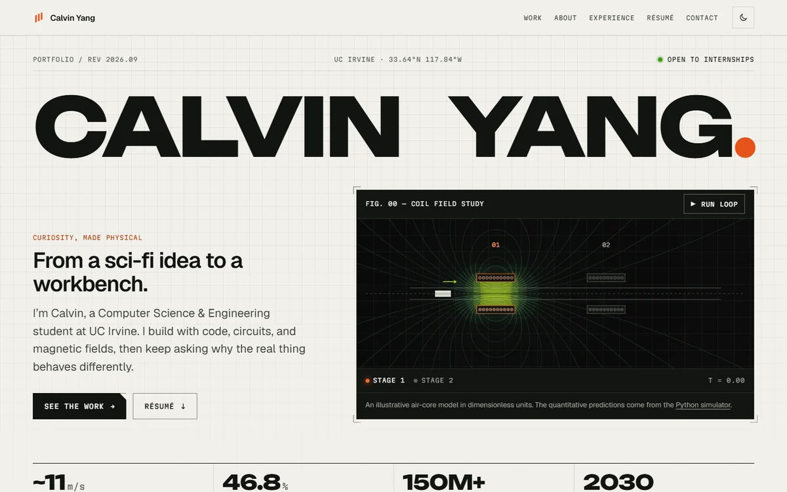

# Calvin Yang — Engineering Portfolio

<picture>
  <source media="(prefers-color-scheme: dark)" srcset="assets/readme/home-dark.webp">
  
</picture>

Personal portfolio site for **Calvin Yang**, a Computer Science & Engineering student at UC Irvine working in embedded systems, electronics, firmware, CAD, and electromagnetic simulation.

**Live site → [someheresy.github.io](https://someheresy.github.io/)**

[](https://someheresy.github.io/)


---

## How this site was built

I built this site with AI. The HTML, CSS, and JavaScript here were written by Claude, not typed by me. My work was everything on either side of that: the visual direction and the look I was after, what each page needed to say, all of the engineering content, photography, simulation captures, and résumé, and the review loop that took each page from close to correct.

I am stating it up front because the projects this site documents — the coil gun, the simulator, the rocketry work, the Arduino system — are hardware and firmware I designed, built, and debugged myself. Those are the work. This site is how I present it, and I would rather the line between the two be explicit than inferred.

---

## What's on the site

A home page (work, about, experience, capabilities, the full résumé inline, contact) and one case study per project:

| Project | Period | Tools | Outcome | Source |
|---|---|---|---|---|
| [Electromagnetic Accelerator](https://someheresy.github.io/projects/electromagnetic-accelerator.html) | 2022 – present | ANSYS Maxwell 2D, Fusion 360, Arduino, 3D printing | ~11 m/s with a 54.64 g projectile | [Stage control](https://github.com/SomeHeresy/Electromagnetic-Accelerator) |
| [Coilgun Timing Simulator](https://someheresy.github.io/projects/coilgun-simulator.html) | Aug – Sep 2026 | Python, NumPy, pytest, GitHub Actions | 46.8% suckback loss quantified; energy conserved to 6e-14 | [Simulator](https://github.com/SomeHeresy/Coilgun-Simulator) |
| [American Rocketry Challenge](https://someheresy.github.io/projects/american-rocketry-challenge.html) | Nov 2025 – Mar 2026 | OpenRocket | 23.2% simulation accuracy gain, official score 139.8 | — |
| [Arduino Sensor & Control System](https://someheresy.github.io/projects/arduino-sensor-control.html) | Jun – Jul 2026 | Arduino Uno R3, C/C++, I²C | Two sensor inputs on a ~100 ms OLED refresh | [Firmware](https://github.com/SomeHeresy/2026-summer-projects/tree/main/Arduino/Advanced) |

The coil gun case study is organised by physical build — V1 (2022, single stage), V2 (two-stage preparation and sensing experiments), V3 (functional two-stage, simulation-informed timing) — with photographs, simulation captures, and video from each.

Two velocity figures appear across the site and they are not the same measurement: the ~11 m/s two-stage result belongs to the physical hardware, while the simulator's 9.64 m/s prediction and 6–7 m/s comparison are single-stage at 350 V.

---

## Design

The look is an **instrument notebook**: a lab notebook by day and an oscilloscope by night.

- **Two themes.** Light ("bench": warm paper, graphite ink) and dark ("scope": near-black glass). The site follows the visitor's system setting until they press the toggle in the header, and remembers the choice. The instrument panels — the coil animation, the simulator card, the wiring diagram, the contact block — stay dark in both.
- **Two accents with jobs.** Copper orange for coils, links and emphasis; signal green for live state: status LEDs, the highlighter, text selection, the primary button in the dark theme.
- **Three typefaces, self-hosted** (about 70 KB in total, all SIL OFL, see [fonts/LICENSE.md](fonts/LICENSE.md)): **Unbounded** for the nameplate, headlines and readouts; **Geist** for reading; **Martian Mono** for labels and measurements.
- **Engineering-drawing details.** Crop-mark brackets frame every figure, numbers appear as readouts with their units, project facts are spec lists, and the footer is a drawing title block (sheet, revision, source).
- **Motion with rules.** Three durations and two easing curves, used everywhere; reveals and decoding labels run once; nothing moves on its own for long. Everything collapses to a static page under `prefers-reduced-motion`.

References that shaped it: Bungie's *Marathon* site (type contrast, bracketed UI chrome, measurement readouts), Intel (restraint and one focal element per screen), Teenage Engineering (spec-sheet micro-type), and Rocket Lab (large, honest hardware photography).

---

## How it works

A static site with no framework, build step, package manager, or runtime dependencies. What is committed is what GitHub Pages serves.

| Layer | Choice |
|---|---|
| Markup | Semantic HTML5, one file per page |
| Styling | One stylesheet ([css/site.css](css/site.css)) in cascade layers; every color is a `light-dark()` token |
| Scripting | Vanilla JavaScript, no libraries |
| Graphics | Canvas 2D for the coil field, inline SVG for the wiring diagram |
| Hosting | GitHub Pages from the root of `main` |

```
.
├── index.html               # Home page
├── 404.html                 # Not-found page (served at any depth, so its paths are absolute)
├── projects/                # One case study per project
├── css/site.css             # The whole design system: tokens, components, page layouts
├── js/
│   ├── head.js              # Runs before first paint: theme, page-transition names
│   ├── site.js              # Menu, theme toggle, reveals, video embeds, wiring diagram
│   ├── coil-field-model.js  # Biot–Savart field model and flux contours (also runs in Node)
│   └── coil-animation.js    # The home page's coil instrument
├── fonts/                   # Unbounded, Geist, Martian Mono (WOFF2) + licenses
├── assets/                  # Photography (originals + WebP), plots, share cards, README images
├── resume/
│   ├── CalvinYangResume.pdf # Stable path — the site always links here
│   └── resume.json          # Parsed résumé; source for the inline HTML
├── tools/
│   ├── site.json            # Titles, descriptions, nav and project order for every page
│   ├── build_pages.py       # Writes the shared page parts from site.json
│   ├── sync_resume.py       # Rebuilds the inline résumé from the PDF / resume.json
│   ├── optimize_images.py   # Photos -> WebP at two sizes; builds the share cards
│   ├── make_home_card.py    # Draws the home page's share card
│   └── test_field_model.cjs # Numerical checks for the coil field model
├── .github/workflows/checks.yml  # Runs every check above on each push
├── favicon.svg, apple-touch-icon.png, robots.txt, sitemap.xml
└── .nojekyll                # Serve files as-is; skip GitHub's Jekyll step
```

---

## Maintaining the site

Every tool below is a maintenance script, not a build step: run it, read the diff, commit. Each has a `--check` mode, and [the CI workflow](.github/workflows/checks.yml) runs all of them on every push so nothing drifts silently.

### Shared page parts — `tools/build_pages.py`

The `<head>` tags, header, footer, each case study's project number and back link, the "next project" link, and `sitemap.xml` are generated from [tools/site.json](tools/site.json). In the HTML they sit between `<!-- BUILD:name -->` markers; everything outside the markers is written by hand.

```bash
python tools/build_pages.py          # rewrite the marked blocks and the sitemap
python tools/build_pages.py --check  # exit 1 if anything is stale
```

It also stamps each CSS/JS link with a short content hash (`site.css?v=…`), so after editing a stylesheet or script, run it once more before committing.

### Résumé — `tools/sync_resume.py`

The résumé lives on the page twice — as the PDF in `resume/` and as semantic HTML inside `index.html` — so the script treats the PDF as input and the HTML as output:

```bash
python tools/sync_resume.py ~/Downloads/NewResume.pdf   # import a new PDF
python tools/sync_resume.py                             # re-render from resume.json
python tools/sync_resume.py --check                     # exit 1 if the page is stale
```

`resume.json` is the editable layer: if the parser misreads something, fix the JSON and re-render. Never hand-edit the HTML between the `RESUME:AUTO` markers. Needs `pypdf`, and only for the import step.

### Images — `tools/optimize_images.py`

Photography ships as WebP twice: capped at 1600 px, and at 800 px (`name-800.webp`) for phones, chosen by `srcset`. The originals stay in the repo as archival copies. The script also renders the 1200×630 share cards in `assets/social/` (JPEG, which link crawlers handle more reliably than WebP), and a rotated landscape copy of the rocket photo.

```bash
python tools/optimize_images.py           # convert anything new
python tools/optimize_images.py --force   # redo everything
python tools/optimize_images.py --check   # exit 1 if an output is missing
```

`python tools/make_home_card.py` redraws the home page's share card with the site's own fonts and colors. Both need Pillow (`pip install Pillow`).

### Numerical checks

```bash
node tools/test_field_model.cjs   # Node 18 or newer
```

Checks field symmetry, divergence, flux-contour tangency, that the fast mirrored grid matches direct computation, the stage-gated trajectory, and the contour extraction. These validate the illustrative model's internal consistency; they do not establish agreement with measured coilgun hardware — that is the Python simulator's job.

### Adding a project

1. Add an entry to `projects` in [tools/site.json](tools/site.json) — its position sets the project number and the "next project" chain.
2. Copy an existing case study to `projects/<slug>.html`, keeping the `BUILD` markers, and write the content.
3. Add its card to the *Selected work* section of `index.html`, with `data-project-image` and `data-project-title` set to the slug so the page transition can carry the image and title across.
4. Put photos in `assets/`, run `tools/optimize_images.py`, and add a `SOCIAL_CARDS` entry for its share image.
5. Run `tools/build_pages.py`, then add a row to the table above.

---

## Running locally

The site needs to be served over HTTP; no install or build is required.

```bash
python -m http.server 8000
```

Then open `http://localhost:8000`. (`npx serve .` or VS Code's Live Server work too.)

> **Do not open `index.html` directly from the file system.** A `file://` page has no HTTP origin, so YouTube refuses to load the embedded project videos and the player reports a configuration error (error 153). Everything else renders, which makes the cause easy to misdiagnose.

---

## Deployment

The repository is a GitHub Pages user site, published from the root of the `main` branch. Any push to `main` redeploys automatically.

`.nojekyll` disables GitHub's default Jekyll step, which would otherwise drop any directory starting with an underscore and try to read `{{ … }}` as template syntax.

---

## Accessibility and performance

- WCAG AA contrast for every text element on every page, in both themes.
- Skip link, landmarks, one `h1` per page, visible focus, and a logical heading order. The menu, theme toggle, videos, and wiring diagram all work from the keyboard; the diagram can also be tapped on touch screens.
- `prefers-reduced-motion` turns off reveals, decoding labels, page transitions, and the highlighter draw-in. The coil animation never starts by itself, pauses when off-screen or in a background tab, and a run always finishes before the loop stops.
- The coil field is built in small idle slices (about 30 ms of work in total on a desktop) instead of blocking page load, and each frame's field picture is cached after the first loop.
- Photography is WebP at two sizes with `srcset`; every image has intrinsic `width`/`height`, so pages do not shift as images arrive. Project videos load as small thumbnails and only become YouTube players when clicked.
- No analytics or trackers. The only third-party requests are YouTube's video thumbnails on the case studies (lazy-loaded as you scroll to them) and the player itself once a video is played.

---

## Contact

- **Email** — [calviny7@uci.edu](mailto:calviny7@uci.edu)
- **LinkedIn** — [linkedin.com/in/calvinyang07](https://www.linkedin.com/in/calvinyang07/)
- **GitHub** — [@SomeHeresy](https://github.com/SomeHeresy)
- **YouTube** — [@SomeHeresyGaming](https://www.youtube.com/@SomeHeresyGaming)

Open to engineering internships, UCI student teams, research opportunities, and projects involving embedded systems, electronics, firmware, or simulation.

---

## Usage

The source is public so others can read how the site is built, and you are welcome to learn from it. Note that the code is AI-generated, so treat it as such — it is not a sample of my own programming.

Project write-ups, photography, and résumé content are personal to me — please do not republish them as your own.
